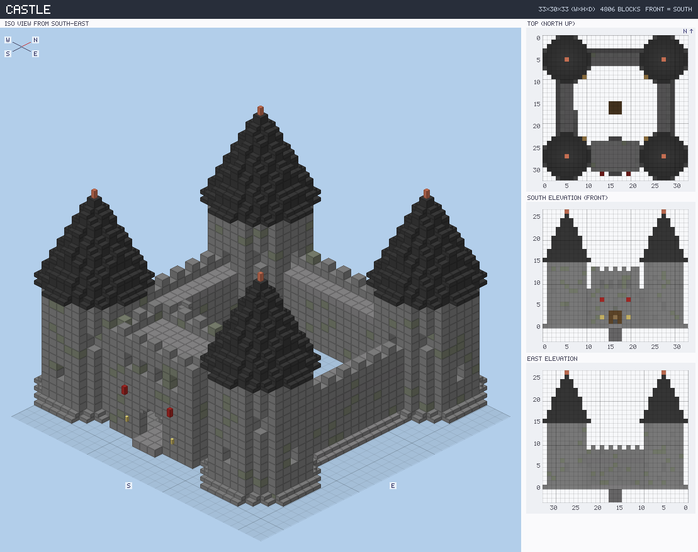
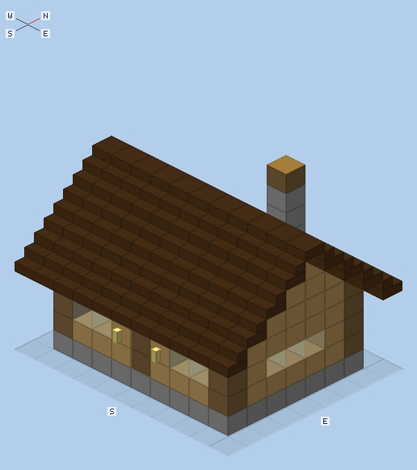
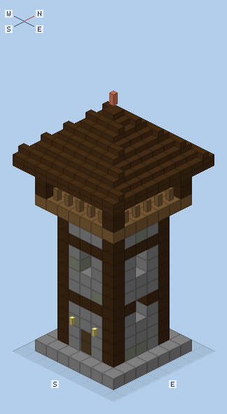
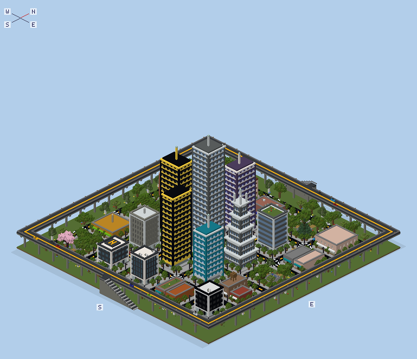
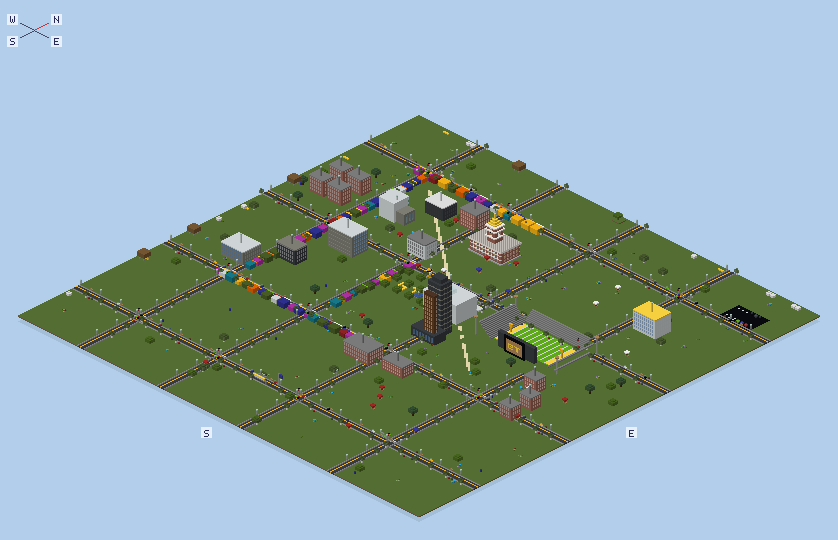
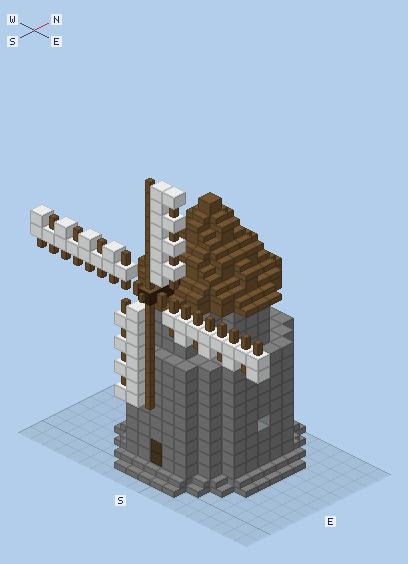
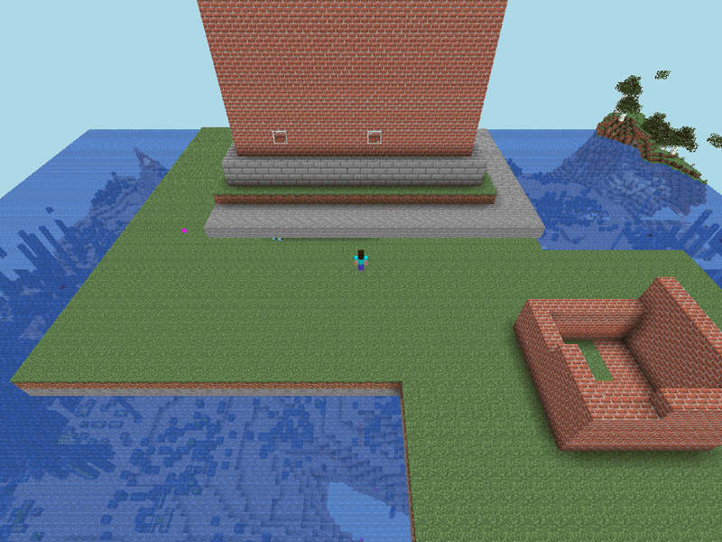

# minecraft-builder-skill

**Let an AI agent (or you) design, preview, build, verify and undo structures in Minecraft Java
Edition** — from a cozy cottage to a whole city, pixel art from a photo, or a schematic you
downloaded. One CLI, `mcb`, does the whole loop and handles every annoying detail (coordinates,
rotation of stairs/doors/logs, placement order, `/fill` limits, chunk loading, rate limits,
operator chat spam, server version quirks).

<p align="center">
  <br>
  <em><code>mcb preview gen:castle</code> — the PNG an AI agent looks at before building.</em>
</p>

```bash
npm install
node bin/mcb.js server setup --accept-eula --op YourName   # local Paper 1.21.11 server (optional)
node bin/mcb.js server start
node bin/mcb.js build gen:house --near YourName --verify    # a house appears in front of you
node bin/mcb.js undo                                        # …and is gone again
```

## Why it's useful

| | |
|---|---|
| **Design the way agents think** | ASCII-layer JSON blueprints, a small JS DSL (`fill`, `sphere`, `paste`, `transformed`…), 19 parametric generators (house, castle, tower, skyscraper, tree, bridge, road, fountain, city, text, pixel art…), or any `.schem` / `.nbt` / `.litematic`. |
| **See before you build** | `mcb preview` renders an isometric view, a top view (north up) and front/side elevations into one PNG — agents (and humans) catch mistakes before touching the world. `mcb plan` says exactly where it lands and what it would replace. |
| **Fast** | Voxels are merged into the fewest `/fill` boxes: a 500-block cottage is ~70 commands, the 445k-block Georgia Tech campus scene builds **and verifies** in about 2 minutes. |
| **Correct** | Block states rotate with the build, doors/beds get both halves, leaves don't decay, torches/plants are placed after their supports, fluids last. `--verify` reads every block back and repairs mismatches. |
| **Safe** | Nothing changes until the blueprint is valid and an undo snapshot is taken; chests/signs are never overwritten without `--force`; `mcb undo` restores what the build changed and leaves later edits alone. Rebuilding only changes what differs. Kicked mid-build? It reconnects and continues. Op command echo is muted and restored, even after a crash. |
| **Works anywhere** | Windows, macOS, Linux. Bot (mineflayer) or RCON transport, any dimension. Single-player worlds via generated data packs. A fresh Paper server in one command, Java auto-install optional. |
| **Agent-first** | [`SKILL.md`](SKILL.md) teaches an agent the workflow; every command has `--json` output and errors come with a stable `code` and a concrete `hint:`; `mcb doctor` diagnoses setups; `mcb mcp` exposes everything as MCP tools (with preview images). |

## Install

Requirements: **Node.js 22+**. To run a local server: Java 21+ (`--install-java` can fetch it).
Mineflayer supports Minecraft Java **1.8 – 26.1**; RCON works with any version.

```bash
git clone https://github.com/wzhaoMS/minecraft-builder-skill
cd minecraft-builder-skill
npm install
node bin/mcb.js doctor
```

Shortcuts: `./setup.sh` (Linux/macOS) or `powershell -ExecutionPolicy Bypass -File setup.ps1`
(Windows) install dependencies and create a local server in `../mc-server`.

### Use with an AI agent

Point your agent (GitHub Copilot, Claude Code, Codex, …) at this repo — the skill file
[`SKILL.md`](SKILL.md) contains the workflow, orientation rules, blueprint formats, generator list,
design guidance and troubleshooting. Then just ask: *"build me a medieval castle next to me"*,
*"put our team logo as pixel art on that wall"*, *"copy this house 50 blocks east"*.

## Commands

| Command | What it does |
|---|---|
| `mcb doctor` | Checks Node, Java, config, server, RCON, bot login and op status — with fixes |
| `mcb server setup\|start\|stop\|status\|logs\|op` | Manage a local Paper server (download via PaperMC API with checksum, EULA, RCON, flat world, ops) |
| `mcb generators [name]` | List generators / show a generator's parameters |
| `mcb info <blueprint>` | Size, block counts, command plan, time estimate, lint warnings |
| `mcb validate <blueprint>` | Check every block state against Minecraft data; suggest fixes for typos |
| `mcb preview <blueprint> -o x.png` | Render iso / top / elevation views to a PNG |
| `mcb plan <blueprint> --at x,y,z \| --near <player>` | Read-only: where it lands, what it replaces (incl. chests/signs), commands needed |
| `mcb build <blueprint> --at x,y,z \| --near <player>` | Build it (`--facing`, `--rotate`, `--mirror`, `--clear`, `--ground`, `--verify`, `--strict`, `--mode fill\|layered\|hand`, `--dimension`, `--dry-run`) |
| `mcb watch <blueprint> --at …` | Rebuild live every time you save the file (only differences are sent; removed parts are restored) |
| `mcb undo [id] [--list] [--force]` | Restore what a build changed; blocks edited since are left alone and listed |
| `mcb snapshot --from … --to … -o x.json` | Copy a region of the world into a blueprint (`--render` for a PNG) |
| `mcb export <blueprint> -o x.schem\|x.nbt\|x.json\|x.mcfunction` | Convert; `--datapack <dir>` makes a data pack for single-player |
| `mcb where [player]` | Player position + facing |
| `mcb cmd "<command>" …` | Run raw server commands |
| `mcb mcp` | Run as an MCP server (stdio) — see [docs/mcp.md](docs/mcp.md) |

`<blueprint>` = a `.json` / `.js` / `.mjs` file, a `.schem` / `.schematic` / `.nbt` / `.litematic`
file, or `gen:<generator>` with `-p key=value` parameters.
Full format reference: [docs/blueprint-format.md](docs/blueprint-format.md).

## Examples

```bash
mcb preview examples/blueprints/cottage.json -o cottage.png       # hand-drawn ASCII-layer blueprint
mcb preview examples/blueprints/watchtower.mjs -p height=20        # parametric JS blueprint
mcb plan  gen:castle -p width=41 -p towerRadius=5 --near Steve    # what would it replace?
mcb build gen:castle -p width=41 -p towerRadius=5 --near Steve --clear --verify
mcb build gen:text -p "text=WELCOME" -p block=gold_block --at 100,70,-20 --facing east
mcb build gen:pixelart -p image=logo.png -p width=64 --at 0,64,0
mcb build gen:city -p width=200 -p depth=200 --at 500,-50,500 --transport rcon
mcb build examples/scenes/gt-campus.mjs --at 300,-55,-500 --clear --verify
mcb export gen:house --datapack "%APPDATA%/.minecraft/saves/MyWorld/datapacks" --name house
```

| | | |
|---|---|---|
| <br>`examples/blueprints/cottage.json` | <br>`examples/blueprints/watchtower.mjs` | <br>`gen:city` |
| <br>`examples/scenes/gt-campus.mjs` (ported from v1) | <br>`gen:windmill` | <br>v1 demo: the bot placing TECH by hand |

## How it works

```
blueprint ─► Structure (sparse 16³ sections + palette) ─► lint (validate, complete doors/beds, support checks)
          ─► placement (anchor, facing, dimension → rotate block states) ─► plan (greedy /fill boxes, phases, 64×64 tiles)
          ─► read-only checks (snapshot for undo, impact, container guard)
          ─► transport (bot: acked batches via /tellraw barriers, rate- and volume-capped, reconnecting │ rcon │ dry-run)
          ─► verify (read back, one repair pass) ─► report (mcb.build-report/1)
```

* **Acknowledged command batches.** Not every Minecraft command answers, so per-command replies
  can't be matched up. `mcb` sends a batch, then `/tellraw @s "mcb:sync:<n>"`; when that comes
  back, everything before it has run and any errors that arrived belong to that batch.
* **Rate limits.** Paper kicks clients above 500 packets/s (averaged over 7 s); `mcb` caps at
  250 commands/s and ~200k changed blocks per acknowledgement, with at most three batches in flight.
* **Chunks.** Since 1.21.9 even spawn chunks aren't kept loaded, so `mcb` works tile by tile:
  the bot hovers over each tile (RCON uses `/forceload`, removing only the tickets it added).
  Block reads come straight from chunk state ids — millions of blocks per second for snapshots
  and verification.
* **Quiet.** Operators normally see every command a bot runs (`[BuilderBot: Changed the block…]`);
  `mcb` switches `send_command_feedback` off for the build and restores it (journaled, so even a
  crash is repaired on the next run).
* **Version quirks.** 1.21.11 renamed gamerules (`sendCommandFeedback` → `send_command_feedback`…)
  and `chain` became `iron_chain`; `mcb` validates against the server version and tries both
  gamerule names. PaperMC's old download API now returns 410 — `mcb` uses the new Fill API.

## Development

```bash
npm test                      # unit tests (no server needed)
MCB_E2E=1 MCB_PORT=25566 MCB_RCON_PASSWORD=… npm run test:e2e   # against a real server
```

CI runs the unit tests on Windows/macOS/Linux × Node 22/24 and an end-to-end job that downloads
Paper, starts it, and builds/verifies/undoes real structures.

## Migrating from v1

| v1 | v2 |
|---|---|
| `./setup.sh` (broken: PaperMC v2 API is gone) | `mcb server setup --accept-eula` (or the new `setup.sh` / `setup.ps1`) |
| `node build-blueprint.js --file x.json --near-player` | `mcb build x.json --near <player>` |
| `node build-fast.js --file x.json --at x,y,z` | `mcb build x.json --at x,y,z` |
| `node build-city.js` | `mcb build gen:city --near <player>` |
| `node build-gt-city.js` / `build-gt-rebuild.js` / `build-details.js` / `build-realism2.js` | `mcb build examples/scenes/gt-campus.mjs --at … --clear` |
| `node fly-tech-placer.js` | `mcb build examples/scenes/tech-tower-letters.mjs --at … --mode hand` |
| `python3 gen-skyscrapers.py` | `mcb export gen:skyscraper -p style=setback -o tower.schem` |
| v1 JSON blueprints (`blocks` / `palette` / `generator`) | still supported as-is |

Also fixed along the way: the bot's hard-coded `version: '1.21.11'` vs the 1.21.1 server,
the hard-coded player name `alphasuperduper`, `/tmp` and `/home/wei` paths, a wrong offline UUID
in the generated `ops.json` (the bot was never actually op'd by it), leaves decaying, mirrored
text, `chain` (now `iron_chain`), floating lanterns, and gamerules silently failing on 1.21.11.

## Credits

Original builds and lessons learned by [@wzhaoMS](https://github.com/wzhaoMS). Built on
[mineflayer](https://github.com/PrismarineJS/mineflayer), [minecraft-data](https://github.com/PrismarineJS/minecraft-data)
and [prismarine-nbt](https://github.com/PrismarineJS/prismarine-nbt). Minecraft is a trademark of
Mojang/Microsoft; this project is not affiliated with them.
